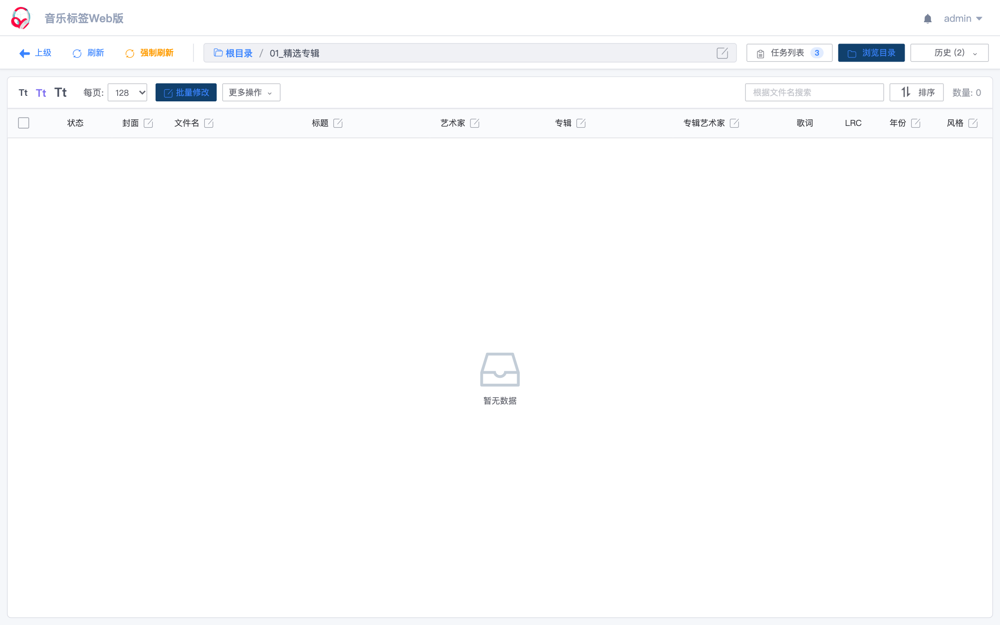
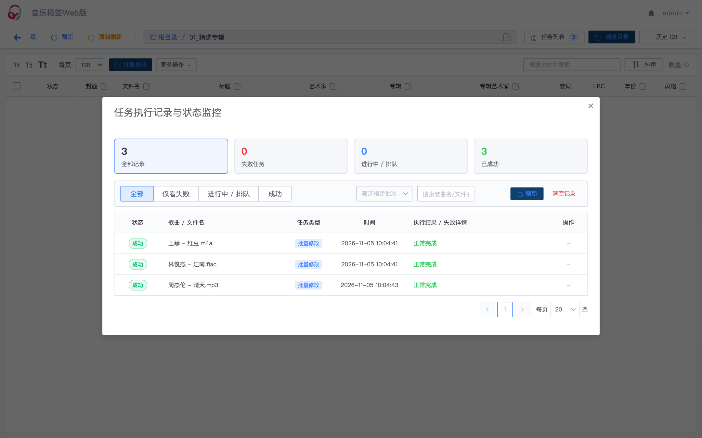

# 🚀 Music Tag Web

**高性能自托管 Docker 音乐标签与元数据批量管理工具**  
*专为 NAS、Homelab、私有音乐服务器打造的 Navidrome / Jellyfin / Emby / Plex 最佳边车伴侣*

<div align="center">

[](https://www.python.org/)
[](#-docker-一键部署指南)
[](https://www.gnu.org/licenses/gpl-3.0)

</div>

---

## 📖 项目简介

**Music Tag Web** 是一款轻量、现代化且高效的**自托管（Self-hosted）Web 音乐标签与元数据管理工具**。

### 为什么需要 Music Tag Web？
在搭建 Navidrome、Jellyfin、Plex、Subsonic 等私有影音服务的过程中，音乐文件通常持久保存在远程 NAS 或 Linux 服务器上。传统的本地桌面端工具（如 Mp3tag、MusicBrainz Picard）必须依赖网络挂载（Samba/NFS/WebDAV），在面对庞大曲库时不仅载入极其缓慢，批量写入还极易因网络抖动造成元数据写入中断甚至文件损坏。

**Music Tag Web 采用纯容器化部署，直接以边车（Sidecar）模式运行在存放曲库的服务器端**：
- **服务端直接 I/O**：所有读写操作均在宿主机本地磁盘完成，修改瞬间生效，完全规避网络传输损耗。
- **全格式支持**：支持 `FLAC`, `APE`, `WAV`, `AIFF`, `WV`, `TTA`, `MP3`, `M4A`, `OGG`, `MPC`, `OPUS`, `WMA`, `DSF`, `DFF`, `MP4` 等几乎全部主流音频格式的 ID3 / Vorbis Comment 元数据管理。
- **隐私与安全**：曲库全部本地处理，无需上传私有音频，适配群晖（Synology）、威联通（QNAP）、绿联（UGREEN）、极空间、Unraid、TrueNAS 及各类 Linux 服务器。

---

## 🖼️ 界面效果预览

### 1. 现代化音乐管理工作台
> 集成目录面包屑跳转、封面极速懒加载、LRC 歌词状态胶囊、Tt 字号调节、平滑过渡刮削候选与单曲编辑抽屉。



### 2. 独立任务中心与批量状态管理
> 全局异步任务监控抽屉，汇总展示成功、失败与排队状态，支持条件筛选、关键字搜索、断点续跑与失败重试。



---

## ✨ 核心特性

### ⚡ 极致性能与缓存架构
- **秒级分页加载**：支持 32 / 64 / 128 / 256 / 512 / 1000 档位自适应分页，万首歌曲大目录秒级开启，告别页面卡死。
- **双层缓存加速**：采用数据库持久化缓存（`MusicMetaCache`）配合内存缓存，避免重复解析音频 ID3 头；专辑封面按需异步流式加载。
- **一键强制刷新**：针对手动替换文件场景，提供“强制刷新”功能，一键清空本地及服务端缓存并深度重扫磁盘。

### 📋 可靠的任务中心与断点续跑
- **可视化任务统计**：顶部常驻动态任务徽标，抽屉内直观呈现“全部记录”、“失败任务”、“进行中/排队”、“已成功”汇总卡片。
- **智能队列管理**：支持按批次与状态筛选历史操作，支持针对报错原因（如网络超时、源无匹配）一键重新提交单条或整批任务。
- **中断恢复机制**：服务重启或意外中断后，支持一键继续执行所有排队中未完成任务（`resume_pending`），批量处理无忧。

### 🛡️ 针对 NAS 机械硬盘深度优化
- **单进程高并发协程**：底层采用 Gunicorn + Gevent 架构，内存占用极低，高并发读取流畅。
- **磁盘写入节流保护**：内置独立专用磁盘写入线程池（默认 4 线程），避免大批量写入时机械硬盘磁头剧烈寻道与 I/O 争抢。
- **存储友好型 SQLite**：针对 NAS/NFS/SMB 网络共享存储优化，使用安全无 mmap 的 `TRUNCATE` 模式与长超时忙等待，彻底避免 WAL 锁死问题。

### 🎯 丰富的标签处理工具箱
- **多数据源在线刮削**：多渠道官方音乐接口兜底匹配，自动补全歌曲标题、艺术家、专辑、发行年份、风格、歌词与高清封面。
- **内置音频声学指纹**：对“Track01.mp3”等完全无标签且文件名混乱的文件，利用音频波形特征提取识别，精准补全元数据。
- **批量文本替换与转换**：支持简繁体一键互相转换、批量标签属性替换与正则清洗。
- **文件名解包提取**：根据自定义格式（如 `${artist} - ${title}`）自动拆解文件名，回填缺失的标签信息。
- **智能曲库归类整理**：支持根据标签变量规则（如 `${artist}/${album}/`）自动重命名文件并建立多级归类文件夹。
- **双语歌词与分轨支持**：支持嵌入歌词翻译、生成独立同名 `.lrc` 歌词文件，集成整轨无损音频（FLAC/APE/CUE）检测与处理。

---

## 🐳 Docker 一键部署指南

官方镜像已全面支持 `linux/amd64` 与 `linux/arm64` 跨平台架构（群晖、威联通、树莓派等直接开箱即用）。

### 方式一：Docker CLI 快速运行（推荐）

```bash
docker run -d \
  --name music-tag-web \
  -p 8001:8001 \
  -e DJANGO_SECRET_KEY="$(openssl rand -hex 32)" \
  -v /volume1/music:/app/media:rw \
  -v /volume1/docker/music-tag/config:/app/data:rw \
  --restart=unless-stopped \
  xhongc/music_tag_web:latest
```

> 💡 **参数说明**：
> - `/volume1/music`：替换为您 NAS 或服务器中存放音乐的实际绝对路径（容器内只读或读写挂载 `/app/media`）。
> - `/volume1/docker/music-tag/config`：替换为您希望保存系统配置与数据库的持久化目录（映射至 `/app/data`）。
> - `DJANGO_SECRET_KEY`：用于 JWT 鉴权签名的唯一密钥，建议使用 `openssl rand -hex 32` 生成，请妥善保存。

---

### 方式二：Docker Compose 编排部署

在目标目录创建 `docker-compose.yml`：

```yaml
version: '3'

services:
  music-tag-web:
    image: xhongc/music_tag_web:latest
    container_name: music-tag-web
    ports:
      - "8001:8001"
    environment:
      DJANGO_SECRET_KEY: "${DJANGO_SECRET_KEY:?Set a unique DJANGO_SECRET_KEY}"
      # 可选：自定义服务端口（默认为 8001）
      # PORT: 8001
      # 可选：磁盘写入并发线程数（默认为 4，保护机械硬盘）
      # WRITE_WORKER_NUM: 4
      # 可选：Gunicorn 进程数（默认为 1，单进程共享协程堆内存）
      # GUNICORN_WORKER_NUM: 1
    volumes:
      - /path/to/your/music:/app/media:rw
      - /path/to/your/config:/app/data:rw
    restart: unless-stopped
```

启动容器：
```bash
# 生成安全密钥并启动
export DJANGO_SECRET_KEY="$(openssl rand -hex 32)"
docker-compose up -d
```

---

## 🔑 访问与初始配置

1. 打开浏览器访问：`http://<您的服务器IP>:8001/`
2. **默认管理员账号**：`admin`
3. **默认管理员密码**：`admin`
4. **安全提示**：首次登录后，请务必前往右上角菜单 **「后台管理」**（或直接访问 `http://<您的服务器IP>:8001/admin/`）修改管理员密码！

---

## ⚙️ 核心环境变量与配置说明

| 环境变量 | 默认值 | 作用与说明 |
| :--- | :--- | :--- |
| `DJANGO_SECRET_KEY` | *(必填)* | 系统安全签名密钥，请配置随机长字符串保障安全 |
| `PORT` | `8001` | 容器内部 Gunicorn 监听端口，宿主机端口映射请同步调整 |
| `WRITE_WORKER_NUM` | `4` | 磁盘写入并发线程池大小；对于机械硬盘曲库建议保持 2~4，避免磁头争抢寻道 |
| `GUNICORN_WORKER_NUM` | `1` | Gunicorn 工作进程数；单进程 + Gevent 协程架构可确保任务中心共享内存状态 |
| `WORKER_NUM` | `8` | 异步请求与在线刮削最大工作线程数 |

---

## 🛠️ 本地测试与二次开发

本项目配备了完整的自动化本地测试环境与构建脚本：

```bash
# 1. 启动完全隔离的独立本地测试环境 (端口 18002，自带预置测试曲库)
./start_test_env.sh

# 2. 重新生成/重置测试曲库样本 (覆盖 MP3/FLAC/M4A/LRC 全场景)
python3 scripts/generate_test_library.py

# 3. 运行端到端集成测试脚本
python3 scripts/test_workflow.py

# 4. 前端独立编译 (Web 目录)
cd web && NODE_OPTIONS=--openssl-legacy-provider npm run build && cd ..

# 5. 一键打包并发布正式生产镜像
./build_release.sh music-tag-web:latest

# 6. 停止测试环境
./stop_test_env.sh
```

---

## 📜 免责声明

1. 本项目基于 **GPL V3.0** 开源许可证发行。
2. 本项目为开源自托管工具，**仅供个人用于学习、研究技术及管理私有已有音频元数据，不提供任何音频下载或版权数据分发功能**。
3. 刮削数据来源于公开网络服务接口，本项目不对第三方数据的准确性与完整性承担担保责任。
4. 禁止将本代码用于任何形式的商业营利行为。因违反所在地法律法规所造成的后果由使用者自行承担。
